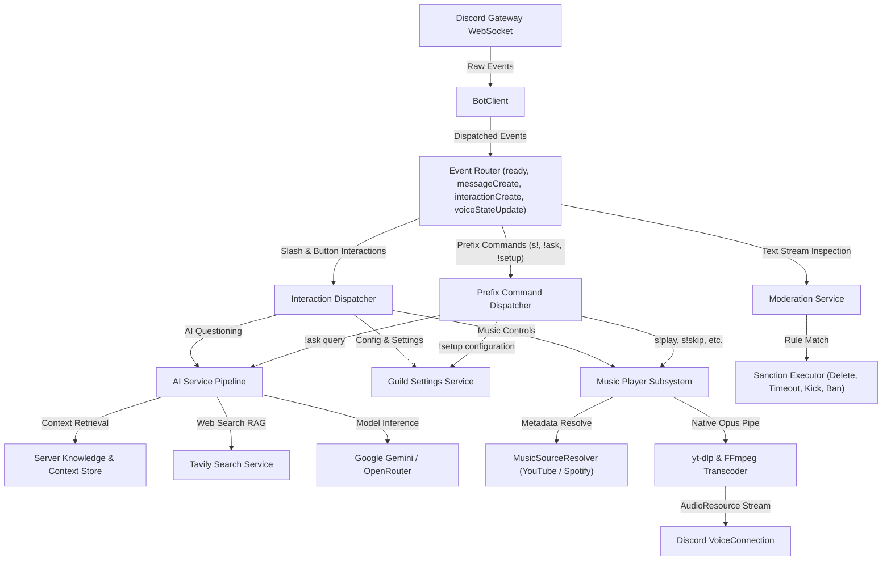

<div align="center">

# Discord Bot Management & Community Automation Platform

### Enterprise-grade Discord.js v14 automation platform featuring multi-provider AI grounding, high-fidelity native audio streaming, automated moderation, and dynamic server configuration.

[](https://nodejs.org/)
[](https://discord.js.org/)
[](https://ffmpeg.org/)
[](https://tavily.com/)
[](docs/SETUP_GUIDE.md)
[](LICENSE)

[Quickstart](#quickstart) · [System Highlights](#system-highlights) · [System Workflow](#system-workflow) · [Documentation Hub](#documentation-hub) · [Deployment](#deployment) · [License](#license)

</div>

---

> [!IMPORTANT]
> **Production Runtime Notice:** The bot requires Discord Privileged Gateway Intents (`MessageContent`, `GuildMembers`, `GuildVoiceStates`) enabled in the Discord Developer Portal. Node.js 18.x or 20+ and FFmpeg are required for native audio playback. Configure all environment variables in your local environment file prior to starting the process.

---

## System Highlights

| Capability | Module | Technical Description |
| :--- | :--- | :--- |
| **Multi-Provider AI Assistant** | `aiService`, `geminiService`, `openrouterService` | Dual-engine fallback pipeline prioritizing Google Gemini (`gemini-2.5-flash`) with automatic failover to OpenRouter upon rate-limit (HTTP 429) or quota exhaustion. Per-guild model customization via slash commands. |
| **Live Web Search Grounding** | `tavilySearchService` | Autonomous real-time search synthesis using Tavily Search Platform. Features a cascading search strategy (basic query elevated to advanced comparative search when insufficient sources are returned) with a 15-minute query cache. |
| **Dynamic Discord Knowledge Base** | `serverKnowledgeService`, `serverContextService` | Automatically extracts server context from pinned channel announcements, designated informational messages, and custom texts. Employs a 3-minute in-memory RAM cache providing 0ms prompt injection latency. |
| **High-Fidelity Audio Engine** | `musicPlayer`, `yt-dlp`, native `FFmpeg` | 48kHz stereo 128kbps native OggOpus streaming pipeline. Bypasses software decoding bottlenecks via native C bindings, eliminating jitter and buffer underflows during high voice-channel concurrency. |
| **Hybrid Spotify & YouTube Resolver** | `musicSourceResolver` | Resolves Spotify albums in under two seconds by querying YouTube official artist album playlists, instantaneously matching the entire track list in memory with LRU caching for repeated tracks. |
| **Automated Moderation & Sanctions** | `moderationService`, `violationStore` | Real-time message content analysis detecting profane, abusive, or hate speech patterns. Enforces progressive sanctions including message deletion, direct-message warnings, temporary timeouts, kicks, and bans. |
| **Server Configuration Hub** | `guildSettingsService`, `channelSetupService` | Independent per-guild isolation for command channel whitelists, welcome/leave notification routing, feature toggle switches, and AI engine model parameters persisted in JSON storage. |

---

## System Workflow

The bot operates an event-driven architecture built on Discord.js v14 Gateway events:



---

## Quickstart

### Prerequisites

- Node.js 18.17.0 or 20.x or higher
- npm 9.x or higher
- FFmpeg installed and accessible in the system PATH
- Python 3.8+ (optional, required if yt-dlp binary is installed via pip)

### 1. Repository Setup

Clone the repository and install project dependencies:

```bash
git clone https://github.com/hoangbmt023/hoangnek_bot_discord.git
cd hoangnek_bot_discord
npm install
```

### 2. Environment Configuration

Copy the template environment configuration file and provide the required secrets:

```bash
cp .env.example .env.development
```

Key environment parameters:

```ini
NODE_ENV=development
DISCORD_TOKEN=your_discord_bot_token_here
CLIENT_ID=your_discord_application_client_id

# AI Provider Configuration
GEMINI_API_KEY=your_gemini_api_key
OPENROUTER_API_KEY=your_openrouter_api_key
TAVILY_API_KEY=your_tavily_search_api_key
```

### 3. Execution

Start the bot in development or production mode:

```bash
# Run in development mode with automatic restarts
npm run dev

# Run in production mode
npm start

# Execute full automated test suite
npm test
```

---

## Documentation Hub

| Document | Scope | Description |
| :--- | :--- | :--- |
| [System Design](docs/SYSTEM_DESIGN.md) | Technical Architecture | Technical breakdown of Gateway routing, audio transcoding pipeline, AI RAG execution, and persistence. |
| [Setup Guide](docs/SETUP_GUIDE.md) | Operations & Deployment | Step-by-step guide for Discord Developer Portal setup, Gateway Intents, credentials, and initial configuration. |
| [Music Guide](docs/MUSIC_GUIDE.md) | Audio Subsystem | Audio streaming parameters, Spotify hybrid resolver, prefix and slash command reference, interactive buttons. |
| [Moderation Guide](docs/MODERATION_GUIDE.md) | Server Protection | Content classification rules, progressive sanction ladders, violation scoring, and whitelist management. |
| [Permissions Guide](docs/PERMISSIONS_GUIDE.md) | Access Control | Discord bot permissions matrix, per-channel enforcement, role hierarchies, and security boundaries. |
| [CI/CD Guide](docs/CICD_GUIDE.md) | Deployment Automation | GitHub Actions automated test workflows and cPanel deployment pipelines via webhooks and SSH. |

---

## Deployment

### Option 1: cPanel Hosting (Setup Node.js App)

cPanel shared hosting runs Node.js applications under CloudLinux LVE and Phusion Passenger:

1. In cPanel, navigate to **Setup Node.js App** and click **Create Application**.
2. Select **Node.js 18.x** or **20.x**, set Application Mode to **Production**, and set the Application Root to the project directory.
3. Set Application Startup File to `index.js`.
4. Add all environment variables from `.env.production` into the Environment Variables panel.
5. Click **Run NPM Install** and restart the application.

### Option 2: Linux VPS (Systemd Service)

Create a dedicated Systemd unit file at `/etc/systemd/system/discord-bot.service`:

```ini
[Unit]
Description=Discord Bot Community Platform
After=network.target

[Service]
Type=simple
User=botuser
WorkingDirectory=/opt/discord-bot
Environment=NODE_ENV=production
ExecStart=/usr/bin/node index.js
Restart=always
RestartSec=10

[Install]
WantedBy=multi-user.target
```

Reload Systemd and enable the service:

```bash
sudo systemctl daemon-reload
sudo systemctl enable --now discord-bot
```

### Option 3: Windows Workstation

For development or dedicated Windows server environments:

```powershell
# Set environment variable and run
$env:NODE_ENV="development"
node index.js
```

---

## License

This project is licensed under the MIT License. See [LICENSE](LICENSE) for full details.