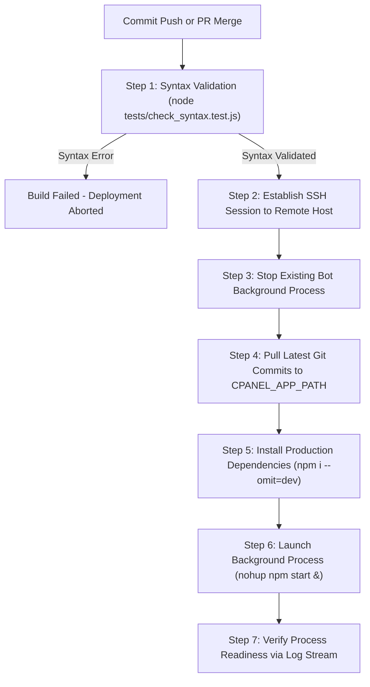

# Automated CI/CD & Deployment Pipeline Guide

> Technical documentation on the GitHub Actions continuous integration workflow, syntax validation stages, and automated continuous deployment over SSH into cPanel hosting environments.

---

## 1. Workflow Triggers & Execution Strategy

The continuous integration and continuous deployment (CI/CD) pipeline is managed via `.github/workflows/deploy.yml` with the following trigger conditions:

- **Pull Requests**: Pull requests targeting `main` trigger the automated CI syntax validation matrix across Node.js versions.
- **Merge to Main**: Merging a pull request into `main` automatically triggers the full deployment sequence.
- **Test Branch Push**: Pushes to `test/cd-deploy` trigger automated deployment directly to the designated testing instance.
- **Manual Trigger**: The pipeline can be dispatched manually via the GitHub Actions **Run workflow** interface.

---

## 2. GitHub Secrets Configuration

To enable remote SSH deployments, configure the following secrets in **GitHub Repository** -> **Settings** -> **Secrets and variables** -> **Actions**:

| Secret Identifier | Required | Example / Description |
| :--- | :--- | :--- |
| `CPANEL_SSH_HOST` | Yes | Server IP address or fully qualified domain name (e.g., `103.xxx.xxx.xxx` or `server.domain.com`). |
| `CPANEL_SSH_USER` | Yes | Remote SSH username configured on the hosting server (e.g., `mtopmqqm`). |
| `CPANEL_SSH_PASSWORD` | Yes | Secure SSH password or authentication token for the hosting user. |
| `CPANEL_SSH_PORT` | Optional | SSH port number (default: `22`). |
| `CPANEL_APP_PATH` | Yes | Target directory path containing the bot repository (e.g., `/home/mtopmqqm/bot/hoangnek_bot_discord`). |
| `CPANEL_ACTIVATE_CMD` | Optional | Shell command activating CloudLinux `nodevenv` (e.g., `source /home/mtopmqqm/nodevenv/bot/hoangnek_bot_discord/18/bin/activate && cd /home/mtopmqqm/bot/hoangnek_bot_discord`). |

---

## 3. Deployment Pipeline Lifecycle

The deployment job executes following this structured sequence:



---

## 4. Diagnostics & Runtime Verification

Upon deployment completion:
1. Verify daemon operation via terminal:
   ```bash
   ps aux | grep node
   ```
2. Inspect application output:
   ```bash
   tail -f logs/app.log
   ```
3. In case of startup failure, review error records located at `logs/error.log` or examine the cPanel Phusion Passenger error log file.
