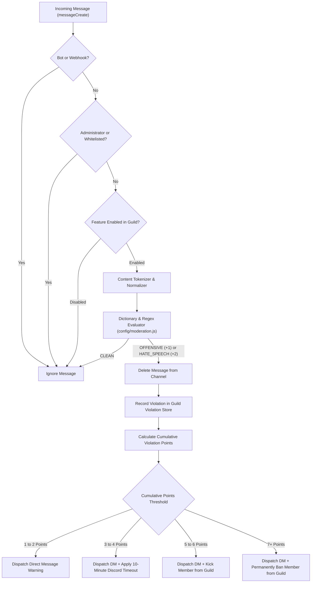

# Content Moderation & Sanctions Operations Guide

> Technical documentation on real-time content filtering, 3-tier severity classification, progressive disciplinary ladders, and whitelist exemptions.

---

## 1. Classification Tiers & Scoring

The moderation engine evaluates incoming message text using rule-based regular expressions and token normalization, categorizing messages into three severity levels:

| Classification | Description | Penalty Points | Enforcement Action |
| :--- | :--- | :--- | :--- |
| **CLEAN** | Standard conversational messages free of profanity or hostile slurs. | `0` | Message permitted with zero action taken. |
| **OFFENSIVE** | Profanity, casual vulgarity, or mild personal insults. | `+1` | Message deleted immediately; warning issued to user. |
| **HATE_SPEECH** | Discriminatory attacks, regional discrimination, severe harassment, or explicit threats. | `+2` | Message deleted immediately; high-severity warning recorded. |

---

## 2. Moderation Execution Workflow

The content analysis pipeline evaluates messages through the following stages:



---

## 3. Progressive Penalty Ladder

Sanctions escalate automatically based on cumulative violation points accrued by an individual user within the guild:

### Tier 1: Warning (1 - 2 Points)
- The violating message is purged from the text channel.
- A private direct message is dispatched to the user specifying the rule violation and current point total.

### Tier 2: Timeout (3 - 4 Points)
- The violating message is purged.
- The Discord Guild Member Timeout API is invoked, restricting the member from sending messages, reacting, or speaking in voice channels for **10 minutes**.

### Tier 3: Guild Kick (5 - 6 Points)
- The violating message is purged.
- The member is kicked from the guild. The user may rejoin via a valid invite link if permitted by server administration.

### Tier 4: Permanent Ban (7+ Points)
- The violating message is purged.
- The member is banned permanently from the guild with a 1-day message deletion history parameter.

---

## 4. Point Decay & Memory Persistence

- **24-Hour Point Decay**: To account for reformed behavior, violation points naturally decrease after 24 hours of inactivity without new infractions.
- **Audit Logging**: All disciplinary actions (timeouts, kicks, bans) are logged to the console and rotating file transports (`logs/bot.log`) with timestamp, guild ID, user ID, and violation reason.

---

## 5. Whitelist Management Commands

Administrators can exempt designated users or roles from automated content moderation:

### 5.1. Slash Commands
```
/setup whitelist add target:@RoleOrUser
/setup whitelist remove target:@RoleOrUser
/setup whitelist list
/setup whitelist clear
```

### 5.2. Prefix Commands
```
!setup whitelist add @User
!setup whitelist remove @User
!setup whitelist list
!setup whitelist clear
```

Whitelist settings are persisted immediately to `data/guild_settings.json` and cached in memory for sub-millisecond evaluation.

---

## 6. Feature Toggle Control

The moderation subsystem can be toggled on or off without restarting the bot:

```
/setup feature toggle feature:moderation
/setup feature enable feature:moderation
/setup feature disable feature:moderation
/setup feature status
```
