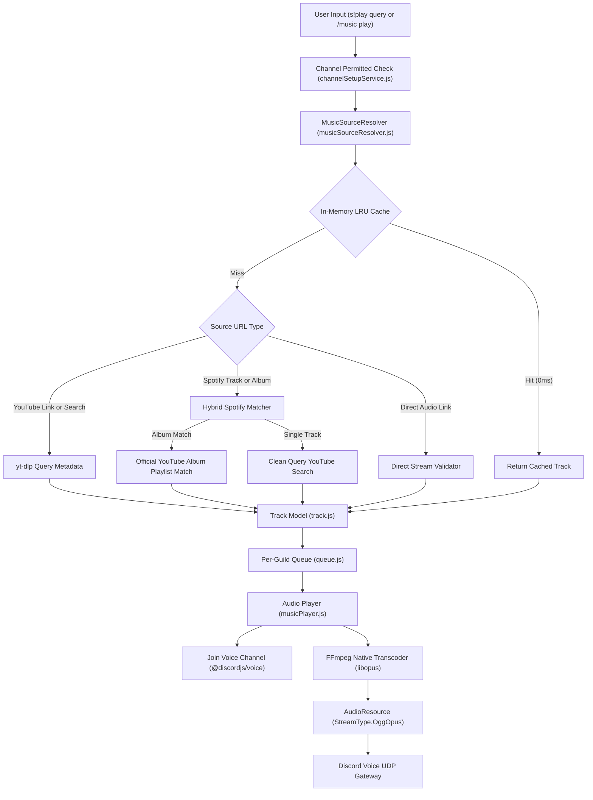

# Music Streaming Engine & Audio Operations Guide

> Detailed specifications for the audio transcoding pipeline, Spotify hybrid resolution engine, voice channel lifecycle, and command control reference.

---

## 1. Audio Pipeline Architecture

The music subsystem processes queries through the following pipeline:



---

## 2. Audio Specifications & Native Transcoding Parameters

Audio streams are piped through FFmpeg using Discord-native Opus specifications to avoid double-encoding overhead:

```bash
ffmpeg \
  -reconnect 1 \
  -reconnect_streamed 1 \
  -reconnect_delay_max 5 \
  -analyzeduration 0 \
  -loglevel 0 \
  -i <audio_source_url> \
  -f ogg \
  -c:a libopus \
  -b:a 128k \
  -ar 48000 \
  -ac 2 \
  -application audio \
  -frame_duration 20 \
  -filter:a "volume=<volume_multiplier>" \
  pipe:1
```

### Technical Parameters

| Parameter | Setting | Rationale |
| :--- | :--- | :--- |
| **Codec** | `libopus` | Native C Opus encoding matching Discord VoIP protocol. |
| **Bitrate** | `128 kbps` | Optimized fidelity balance between bandwidth and acoustic quality. |
| **Sample Rate** | `48000 Hz` | Discord native audio engine sample frequency. |
| **Channels** | `2 (Stereo)` | Full two-channel stereo spatial field. |
| **Frame Duration** | `20 ms` | Discord standard packetization duration per UDP audio datagram. |
| **Stream Type** | `StreamType.OggOpus` | Stream parsed directly by Discord voice library without Node.js `opusscript` re-encoding. |

---

## 3. Music Source Resolution

### 3.1. YouTube & YouTube Music
- **Supported Formats**: Direct video URLs (`youtube.com/watch?v=...`, `youtu.be/...`), public playlist URLs (`youtube.com/playlist?list=...`), and natural search queries (`s!play <query>`).
- **Pipeline**: Handled via `yt-dlp` with metadata parsing. In queries, the engine takes the top-ranked result while filtering out short videos (<30s), loop videos (1-10 hours), and unverified reactions.

### 3.2. Spotify (Hybrid Album Resolver)
- **Supported Formats**: Track URLs (`open.spotify.com/track/...`), Album URLs (`open.spotify.com/album/...`), and Playlist URLs.
- **LRU In-Memory Cache**: Stores up to 1,000 recently resolved tracks with a 2-hour TTL. Repeated queries resolve in 0ms.
- **Album Ingestion**:
  1. Searches YouTube for the official album playlist corresponding to the Spotify album metadata (`Album Name + Artist`).
  2. If matched, resolves the entire 10-20 track album in ~1.8 seconds via a single playlist lookup.
  3. Missing or bonus tracks are fetched via targeted individual lookups.

### 3.3. Direct Audio Files
- **Supported Formats**: URLs ending in `.mp3`, `.flac`, `.wav`, `.ogg`, `.m4a`.
- **Validation**: Verifies HTTP headers (`Content-Type: audio/*`) before streaming to prevent malicious arbitrary downloads.

### 3.4. Unsupported Sources
To maintain performance and security, unsupported platforms (SoundCloud, TikTok, Facebook, Instagram) are rejected with an explicit notification embed.

---

## 4. Command Reference

The music subsystem is accessible via the dedicated prefix `s!` or via Slash Commands (`/music`).

| Prefix Command | Slash Command | Arguments | Description |
| :--- | :--- | :--- | :--- |
| `s!play <query>` | `/music play <query>` | Track title or URL | Enqueues a track, album, or playlist. Joins user voice channel if not connected. |
| `s!pause` | `/music pause` | None | Pauses active playback stream. |
| `s!resume` | `/music resume` | None | Resumes paused playback stream. |
| `s!skip` | `/music skip` | None | Skips the current track to the next queue item. |
| `s!stop` | `/music stop` | None | Halts playback, clears the queue, and resets the player state. |
| `s!queue` / `s!q` | `/music queue` | `[page]` (Optional) | Displays the paginated queue list with interactive page navigation. |
| `s!np` | `/music nowplaying` | None | Displays real-time progress bar, track metadata, and volume. |
| `s!volume <0-150>` | `/music volume <0-150>` | Volume percentage | Adjusts volume dynamically using FFmpeg volume multiplier. |
| `s!loop <off\|track\|queue>` | `/music loop <mode>` | Loop mode | Toggles loop mode (`off`, single `track`, or entire `queue`). |
| `s!shuffle` | `/music shuffle` | None | Shuffles remaining tracks in the queue using Fisher-Yates algorithm. |
| `s!remove <index>` | `/music remove <index>` | Track index | Removes a designated track from the queue by position. |
| `s!clear` | `/music clear` | None | Removes all upcoming tracks while keeping current track playing. |
| `s!leave` | `/music leave` | None | Disconnects the bot from the voice channel immediately. |

---

## 5. Interactive Player Interface

When a track begins playing, the bot sends an embed accompanied by interactive Discord button components:

### 5.1. Player Control ActionRow
Contains 8 interaction buttons:
- **Play / Pause**: Toggles audio player state between playing and paused.
- **Skip**: Triggers track advancement.
- **Stop**: Terminates playback and clears queue.
- **Loop**: Cycles loop state (`OFF` -> `TRACK` -> `QUEUE` -> `OFF`).
- **Shuffle**: Shuffles queue items.
- **Volume Down**: Decreases volume by 10%.
- **Volume Up**: Increases volume by 10%.
- **Queue View**: Dispatches current queue embed to the interaction channel.

### 5.2. Queue Pagination ActionRow
When viewing queues with more than 10 tracks, a 5-button pagination row is rendered:
- `First Page`: Jumps to page 1.
- `Previous Page`: Decrements current page index.
- `Page Indicator`: Disabled button displaying `Page X / Y`.
- `Next Page`: Increments current page index.
- `Last Page`: Jumps to final page.

Buttons from previous track messages are automatically deactivated upon track transitions to avoid stale interaction states.

---

## 6. Voice Connection Lifecycle & Resource Management

- **Auto-Leave on Idle**: If the audio player remains in an `idle` state for 3 consecutive minutes without new track insertions, the bot automatically disconnects from the voice channel and releases the UDP socket.
- **Auto-Leave on Empty Channel**: When all non-bot members leave the voice channel, the bot triggers an automatic disconnection to save host server bandwidth and CPU cycles.
- **Channel Restriction**: If restricted channels are configured via `/setup channel add`, music commands executed outside the designated channel are rejected.
