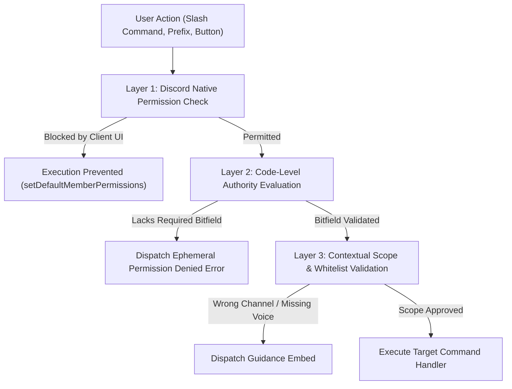

# Permissions & Access Control Architecture Guide

> Technical reference detailing the three-layer security model, role-based access control, command permission matrices, and required Discord application scopes.

---

## 1. Security Architecture

The platform enforces access boundaries using a 3-layer security model:

1. **Layer 1: Discord Native Permission Enforcement**: Slash commands define `.setDefaultMemberPermissions(PermissionFlagsBits.ManageGuild)` and `.setDMPermission(false)`, restricting unauthorized members directly within the Discord client UI.
2. **Layer 2: Code-Level Authority Evaluation**: Handlers verify caller bitfields (`member.permissions.has(...)`) independently to prevent privilege escalation via synthetic API packets.
3. **Layer 3: Contextual Scope Validation**: Verifies dynamic constraints including active voice channel membership, command-whitelisted text channels (`channelSetupService`), and content moderation bypass lists (`whitelistService`).

---

## 2. Command Permission Matrix

| Feature Area | Representative Commands | Required Caller Permissions | Contextual Constraints | Authorized Audience |
| :--- | :--- | :--- | :--- | :--- |
| **AI Model Configuration** | `/setup ai` `!setup ai` | `Administrator` or `ManageGuild` | Guild context only; DM execution rejected. | Server Administrators |
| **Knowledge Base Ingestion** | `/setup knowledge` `!setup knowledge` | `Administrator` or `ManageGuild` | Target channels/messages must exist within the guild. | Server Administrators |
| **Notification Routing** | `/setup notify` `!setup notify` | `Administrator` or `ManageGuild` | Target channel must be an active text channel. | Server Administrators |
| **Channel Whitelisting** | `/setup channel` `!setup channel` | `Administrator`, `ManageGuild`, or `ManageChannels` | Guild context only. | Server Administrators |
| **Feature Toggles** | `/setup feature` `!setup feature` | `Administrator` or `ManageGuild` | Guild context only. | Server Administrators |
| **Moderation Whitelist** | `/setup whitelist` `!setup whitelist` | `Administrator`, `ManageGuild`, or `ManageMessages` | Guild context only. | Server Administrators & Moderators |
| **AI Questioning** | `/ask` `!ask` | `@everyone` (All members) | Rate limit: 1 request / 5 seconds per user. | All Guild Members |
| **Music Playback** | `/music` `s!play`, `s!skip`... | `@everyone` (All members) | User must be in voice channel; must use permitted text channel. | All Guild Members |
| **Interactive Buttons** | Play/Pause, Skip, Stop | `@everyone` (In voice channel) | User must occupy the same voice channel as the bot. | Active Voice Listeners |
| **System Help** | `/help` `!help`, `s!help` | `@everyone` (All members) | None. | All Guild Members |

---

## 3. Discord Bot Application Permissions

To operate all features without permission errors, the bot requires the following permission bitfields granted upon invitation:

### 3.1. Text Channel & Moderation Permissions

| Permission | Bitfield Value | Purpose |
| :--- | :--- | :--- |
| `ViewChannel` | `1024` | Viewing text and voice channels across the server. |
| `SendMessages` | `2048` | Dispatching text notices, command responses, and help guides. |
| `ManageMessages` | `8192` | Deleting profane, toxic, or hate-speech messages automatically. |
| `EmbedLinks` | `16384` | Rendering rich embeds for music cards, AI responses, and alerts. |
| `AttachFiles` | `32768` | Uploading diagnostic logs or audio assets when required. |
| `ReadMessageHistory` | `65536` | Reading channel history for `/setup knowledge` context ingestion. |
| `ModerateMembers` | `1099511627776` | Executing temporary timeouts on members who exceed violation thresholds. |
| `KickMembers` | `2` | Expelling chronic moderation violators from the server. |
| `BanMembers` | `4` | Permanently banning severe hate speech or malicious accounts. |

### 3.2. Voice Channel Permissions

| Permission | Bitfield Value | Purpose |
| :--- | :--- | :--- |
| `Connect` | `1048576` | Joining voice channels requested by users. |
| `Speak` | `2097152` | Streaming audio packets over Discord voice UDP sockets. |
| `UseVoiceActivity` | `33554432` | Maintaining continuous voice stream transmission. |

---

## 4. Channel Whitelisting Security Model

When a guild activates channel restrictions via `/setup channel add channel:#commands scope:all`:
- All prefix and slash commands outside the approved channel list are immediately denied.
- Moderation continues to run globally across all text channels unless explicitly whitelisted in `whitelistService`.
- Reverting to open access is achieved via `/setup channel clear`.
