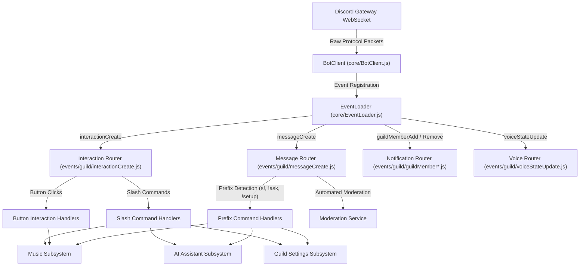
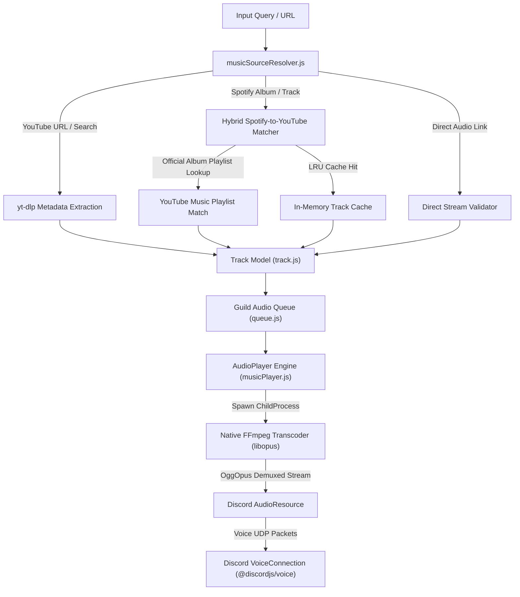
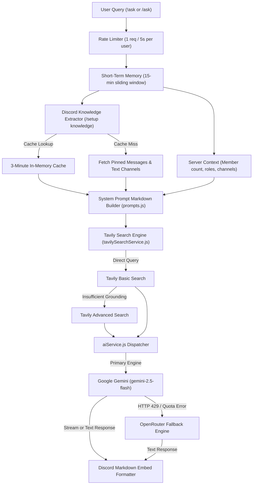
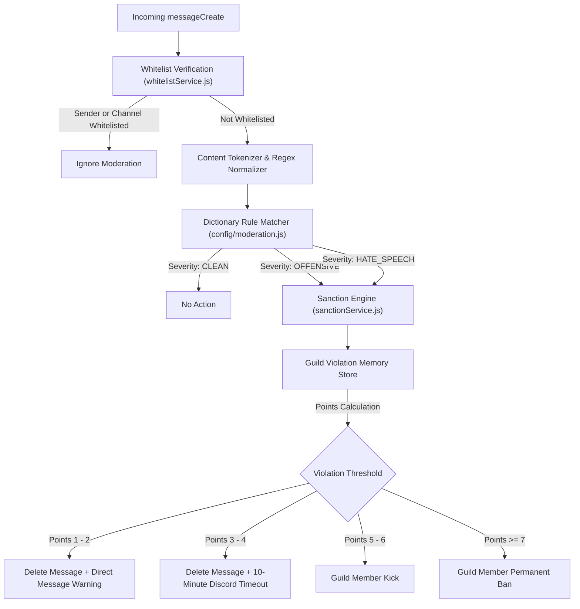

# System Design & Execution Pipeline

> Comprehensive technical breakdown of the Discord Gateway event router, native audio streaming pipeline, multi-provider AI grounding engine, content moderation filter, and configuration persistence.

---

## 1. High-Level System Architecture

The application runs as a persistent Node.js daemon connected to the Discord Gateway via WebSocket connections, executing an asynchronous event-driven lifecycle:



---

## 2. Directory Structure & Module Responsibilities

The codebase separates concerns across dedicated functional directories:

```
hoangnek_bot_discord/
├── index.js                               # Application bootstrap entry point
├── package.json                           # Dependency definitions and lifecycle scripts
├── .env.example                           # Template environment configuration
├── data/
│   └── guild_settings.json                # Local JSON state store for guild configurations
├── src/
│   ├── config/                            # Environment parsing and runtime constants
│   │   ├── env.js                         # Validation and loading of .env variables
│   │   └── moderation.js                  # Keyword dictionaries and violation scoring rules
│   │
│   ├── core/                              # Bot kernel and event loading
│   │   ├── BotClient.js                   # Extended Discord Client with client state management
│   │   └── EventLoader.js                 # Automatic recursive event scanner and binder
│   │
│   ├── commands/                          # Slash command specifications
│   │   ├── slashCommands.js               # Global slash command registry and REST deployment
│   │   └── builders/                      # Slash command builders
│   │       ├── askCommandBuilder.js       # /ask specification
│   │       ├── helpCommandBuilder.js      # /help specification
│   │       ├── musicCommandBuilder.js     # /music specification
│   │       ├── setupCommandBuilder.js     # /setup parent command builder
│   │       └── setup/                     # /setup subcommand groups
│   │           ├── aiGroup.js             # /setup ai subcommands
│   │           ├── channelGroup.js        # /setup channel subcommands
│   │           ├── featureGroup.js        # /setup feature subcommands
│   │           ├── knowledgeGroup.js      # /setup knowledge subcommands
│   │           ├── notifyGroup.js         # /setup notify subcommands
│   │           └── whitelistGroup.js      # /setup whitelist subcommands
│   │
│   ├── events/                            # Gateway event listeners
│   │   ├── BaseEvent.js                   # Base event template
│   │   ├── client/
│   │   │   └── ready.js                   # Client readiness and status updater
│   │   └── guild/
│   │       ├── guildCreate.js             # Bot guild join initialization
│   │       ├── guildMemberAdd.js          # Member join notification trigger
│   │       ├── guildMemberRemove.js       # Member leave notification trigger
│   │       ├── interactionCreate.js       # Slash and button interaction router
│   │       ├── messageCreate.js           # Prefix parser and message moderation router
│   │       └── voiceStateUpdate.js        # Auto-leave voice room monitor
│   │
│   ├── services/                          # Business logic modules
│   │   ├── ai/                            # AI assistant modules
│   │   │   ├── aiService.js               # Primary AI dispatcher with fallback logic
│   │   │   ├── geminiService.js           # Google Gemini API connector
│   │   │   ├── openrouterService.js       # OpenRouter API connector
│   │   │   ├── tavilySearchService.js     # Live search grounding via Tavily
│   │   │   ├── serverKnowledgeService.js  # Discord guild knowledge base extractor
│   │   │   ├── serverContextService.js    # Guild metadata and member statistics extractor
│   │   │   └── prompts.js                 # Markdown system prompt builder
│   │   │
│   │   ├── moderation/                    # Content moderation modules
│   │   │   ├── moderationService.js       # Text scoring and sanction enforcement
│   │   │   ├── sanctionService.js         # Progressive penalty execution
│   │   │   └── whitelistService.js        # Exemption resolution
│   │   │
│   │   ├── music/                         # Audio playback engine
│   │   │   ├── musicPlayer.js             # VoiceConnection and AudioPlayer wrapper
│   │   │   ├── musicSourceResolver.js     # URL parsing, YouTube matching, and Spotify resolution
│   │   │   ├── track.js                   # Track data model and formatting
│   │   │   └── queue.js                   # Per-guild playback queue state
│   │   │
│   │   └── settings/                      # Configuration and persistence
│   │       ├── guildSettingsService.js    # JSON read/write persistence coordinator
│   │       ├── channelSetupService.js     # Allowed command channel verification
│   │       ├── setupSlashHandler.js       # Slash command routing for /setup
│   │       └── handlers/                  # Granular configuration handlers
│   │           ├── aiSetupHandler.js
│   │           ├── channelSetupHandler.js
│   │           ├── featureSetupHandler.js
│   │           ├── knowledgeSetupHandler.js
│   │           ├── notifySetupHandler.js
│   │           └── whitelistSetupHandler.js
│   │
│   └── utils/                             # Shared utility libraries
│       ├── logger.js                      # Multi-transport logger with credential masking
│       ├── embedBuilder.js                # Centralized embed generation facade
│       └── embeds/                        # Domain-specific Discord embed builders
│           ├── aiEmbeds.js
│           ├── colors.js
│           ├── helpEmbeds.js
│           ├── moderationEmbeds.js
│           ├── musicEmbeds.js
│           ├── notificationEmbeds.js
│           └── settingsEmbeds.js
│
└── tests/                                 # Automated test suites
    ├── check_syntax.test.js               # Recursive syntax validation
    ├── moderation.test.js                 # Content moderation filter tests
    ├── ai.test.js                         # AI prompt, knowledge, and fallback tests
    ├── music_buttons.test.js              # Audio UI and button interaction tests
    ├── music_setup.test.js                # Audio resolution and channel setup tests
    └── notification_setup.test.js         # Multi-guild notification routing tests
```

---

## 3. Audio Streaming & Native Transcoding Pipeline

The music subsystem streams high-fidelity audio into Discord voice channels with sub-second track resolution.



### 3.1. Transcoding Pipeline Execution

The system executes FFmpeg with zero-software intermediate files, piping the audio stream directly to the Discord Voice UDP socket:

```bash
ffmpeg \
  -reconnect 1 \
  -reconnect_streamed 1 \
  -reconnect_delay_max 5 \
  -analyzeduration 0 \
  -loglevel 0 \
  -i <source_audio_stream_url> \
  -f ogg \
  -c:a libopus \
  -ar 48000 \
  -ac 2 \
  -b:a 128k \
  pipe:1
```

- `-analyzeduration 0`: Eliminates initial header parsing latency, beginning playback immediately.
- `-c:a libopus`: Utilizes native C Opus encoding to avoid double-encoding in Node.js runtime.
- `-ar 48000 -ac 2`: Strictly matches Discord native audio input specifications (48kHz stereo).
- `-b:a 128k`: Provides consistent bitrates without buffer starvation.

### 3.2. Hybrid Spotify Resolution Engine

Resolving multi-track Spotify albums sequentially via YouTube search causes significant latency (20-30 seconds for a standard 15-track album). The hybrid resolver mitigates this:

1. **Album Playlist Matching**: Searches YouTube for the official artist album playlist corresponding to the Spotify album title and artist.
2. **Instant Bulk Ingestion**: If an official YouTube album playlist is found, all track URLs are imported in a single network round-trip (~1.8 seconds total).
3. **Selective Single Search**: Only tracks missing from the YouTube playlist are resolved individually.
4. **LRU In-Memory Cache**: Up to 1,000 resolved track queries are held in memory with a 2-hour TTL, enabling instant (0ms) resolution for looped tracks or repeated requests.

---

## 4. Multi-Provider AI Assistant Engine & RAG Grounding

The AI subsystem processes conversational inquiries through a multi-tier fallback pipeline with search grounding and contextual data extraction:



### 4.1. Grounding Latency & In-Memory Knowledge Cache

To eliminate Discord API rate limits when answering questions about server rules:
- Pinned messages from configured channels and designated custom texts are combined into a consolidated text payload.
- Stored in a RAM cache keyed by guild ID with a 3-minute Time-To-Live (TTL).
- Subsequent user questions retrieve the entire knowledge context in 0ms without generating Discord Gateway or REST API calls.

---

## 5. Automated Content Moderation & Sanctions Engine

The moderation engine inspects incoming messages across text channels in real time:



Violation points naturally decay after 24 hours of inactivity, allowing rehabilitated users to return to good standing without manual administrator intervention.

---

## 6. Configuration Persistence & State Management

Guild settings are persisted to disk using a synchronous file write pattern backed by in-memory caching:

- **Storage Location**: `data/guild_settings.json`
- **Isolation**: Each configuration root is indexed by `guildId`, isolating server state completely.
- **Fields Persisted**:
  - `channels`: Map of permitted text channels for music, bot commands, and general use.
  - `notifications`: Custom welcome and leave announcement channel IDs.
  - `features`: Feature toggle flags (`moderation`, `welcome`, `leave`).
  - `whitelist`: Arrays of exempted user IDs and role IDs.
  - `ai`: Custom model configuration and default provider preference.
  - `knowledge`: Pinned channel IDs, explicit message IDs, and custom text chunks.
